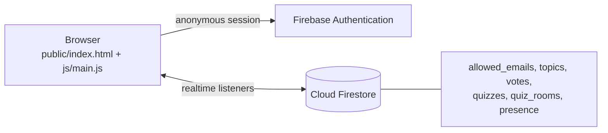

# RoundTable

A small web app for running a team's weekly general meeting: people propose topics, the team
votes on what to discuss, past sessions are kept as history, and a live quiz can be run for
fun. It is plain JavaScript with no build step, backed by Firebase, and it is in real use
by a team of about 50.

## Features

- **Topics**: members submit discussion topics and edit them; admins mark topics as
  discussed or remove them
- **Voting**: members vote on the topics for the next meeting, with a chart of the results
  (Chart.js) and a turnout view; admins set the voting mode, clear the votes and nudge
  people who have not voted
- **History**: previous sessions and their outcomes
- **Quiz**: build a quiz, open a room, and let players join and answer live, with sound
  effects (Tone.js)
- **Members** (admin): add and remove members, change roles, and see who is online
- Dark and light themes, a sound on/off switch, and a responsive layout

## Stack

Vanilla JavaScript (ES modules), HTML and CSS, Firebase Hosting and Cloud Firestore,
Firebase Authentication (anonymous sessions), Chart.js and Tone.js from a CDN.
There is nothing to install or build.

## How it works



| Collection | Holds |
| --- | --- |
| `allowed_emails` | One document per member: name and role (`member` or `admin`) |
| `topics` | Proposed discussion topics and whether they were discussed |
| `votes` | Each member's votes for the current session |
| `quizzes` and `quiz_rooms` | Quiz definitions and live rooms |
| `presence` | Who is online (a heartbeat per member) |

## Run it

1. Create a Firebase project. Turn on **Cloud Firestore** and, under Authentication, the
   **Anonymous** sign-in provider.
2. Put your project's web app settings and an admin email in
   `public/js/firebase-config.js`.
3. Serve the `public/` folder locally, for example:

   ```bash
   cd public
   python -m http.server 8000      # then open http://localhost:8000
   ```

4. Add your members. Either sign in as the admin and use the Members tab, or edit the
   sample list in `tools/seed.example.html`, serve the repository root, and open that page
   once.
5. Deploy with `firebase use --add` and then `firebase deploy`. The hosting config serves
   only the `public/` folder, so files outside it are never published.

## Known limitations

This started as an internal tool for a trusted team, and its access control reflects that.
Please read this before using it for anything sensitive.

- **Login is an allow-list, not authentication.** A person types an email, the app starts an
  anonymous session and checks that the email exists in `allowed_emails`. Nothing proves
  the person owns that email.
- **Roles are enforced in the browser only.** The signed-in user, including the admin role,
  is kept in `localStorage`, and admin screens are hidden by the client.
- **The Firestore rules are permissive** (`request.auth != null`), so any session, including
  an anonymous one, can read and write every collection.

A hardening plan would replace this with real sign-in (Google restricted to a company
domain, or an email link), keep the signed-in identity in Firebase Auth rather than
`localStorage`, and write rules that compare `request.auth.token.email` with
`allowed_emails` and require the `admin` role for admin writes. The current code does not
include that yet.

There is no automated test suite.
